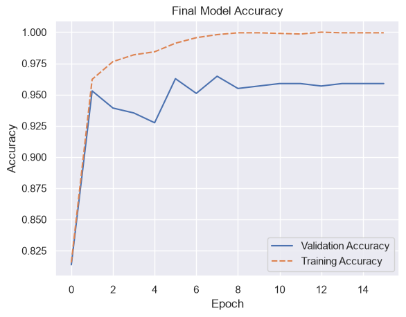
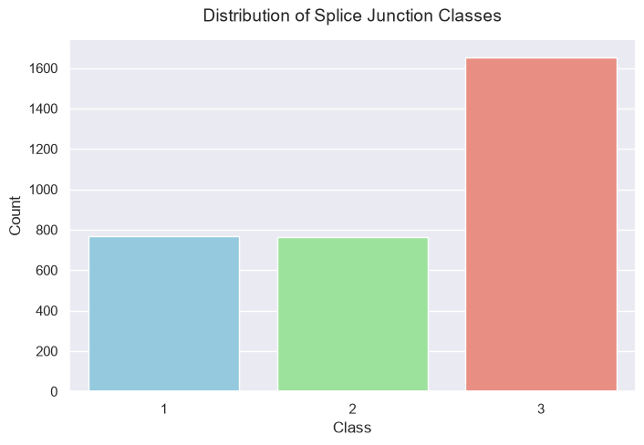

# DNA Splicing Prediction using Deep Learning

In genomics, splice junctions are points on a DNA sequence wherein "superfluous" DNA is removed during the process of protein creation. This project aims to accurately classify DNA sequences into three categories (Intron-Exon boundaries, Exon-Intron boundaries, or neither) using the [Splice Junction Gene Sequences dataset](https://www.kaggle.com/datasets/muhammetvarl/splicejunction-gene-sequences-dataset/). 

For the full code, please refer to splicing.ipynb.

# Dataset

| Base | A1 | A2 | A3 |
| - | - | - | - |
| A | 1 | 0 | 0 |
| C | 0 | 1 | 0 |
| G | 0 | 0 | 1 |
| T | 0 | 0 | 0 |

The dataset is in the form of 180 A_n x entries, where every 3 entries code for a single base.
The table of this encoding is shown below.

| Row | A0 | A1 | A2 | A3 | A4 | A5 | ... | A175 | A176 | A177 | A178 | A179 | class |
| --- | --- | --- | --- | --- | --- | --- | --- | --- | --- | --- | --- | --- | --- |
| 0 | 0 | 1 | 0 | 0 | 0 | 0 | ... | 0 | 1 | 1 | 0 | 0 | 3 |
| 1 | 0 | 0 | 1 | 0 | 0 | 1 | ... | 0 | 0 | 0 | 1 | 0 | 3 |
| 2 | 0 | 0 | 1 | 0 | 0 | 1 | ... | 0 | 1 | 0 | 0 | 1 | 3 |
| 3 | 0 | 0 | 0 | 0 | 0 | 0 | ... | 0 | 1 | 0 | 0 | 1 | 1 |
| 4 | 0 | 1 | 0 | 0 | 0 | 0 | ... | 1 | 0 | 1 | 0 | 0 | 2 |

